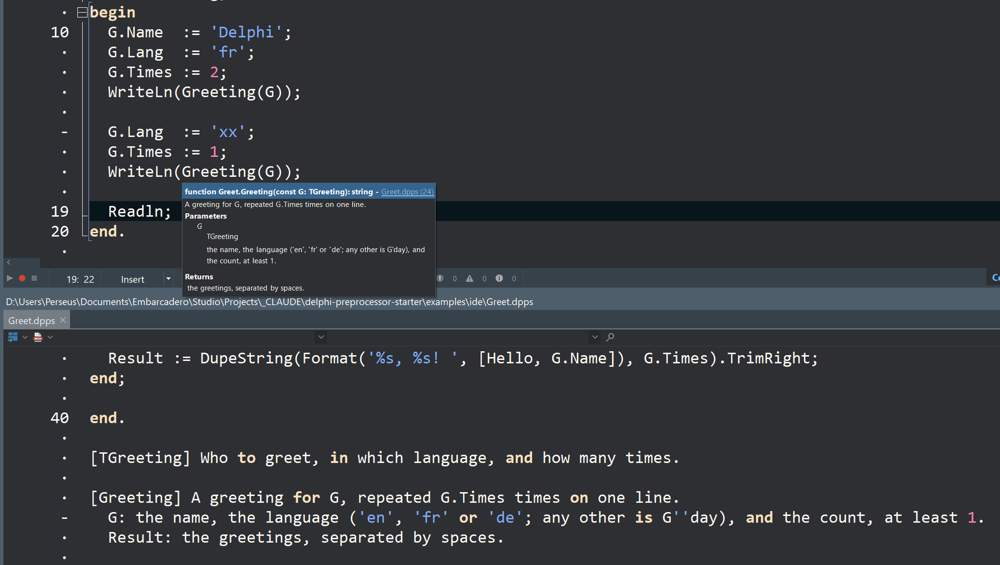

# The rules in the Delphi IDE: a `.dpps` source and a pre-build event

`Greet.dpps` is Delphi source the rules rewrite before dcc sees it. Before every build, the
project's pre-build event runs them and writes `Greet.pas` beside it; the IDE then builds as
usual. No IDE package, nothing installed: a project setting.

Here the rules make a unit dcc would refuse into one it compiles:

| In `Greet.dpps` | In `Greet.pas`, written from it |
|---|---|
| `unit Greet.dpps;`, so the IDE's tabs and lists tell the two apart | `unit Greet;` |
| two `uses` clauses, each with its comment | one clause (`uses-merge`) |
| `[Derive(ToString)]` on `TMood = (Calm, Excited)` | `TMoodHelper`, a record helper whose `ToString` gives `'Calm'` or `'Excited'`, so `G.Mood.ToString` compiles (`derive`) |
| `case G.Lang of 'en': … 'fr': …` (a `case` on strings) | an `if` chain, each arm on its own line (`case-of`) |
| `Assert(G.Times > 0)` | `Assert(G.Times > 0, 'G.Times > 0')`, failing as `G.Times > 0 (…\Greet.dpps, line 30)` (`assert-message`; the file and line are dcc's, from `{$LINE}`) |
| footnotes after `end.`: `[Greeting] A greeting for G, …`, with `G:` and `Result:` lines | XMLDoc above `TGreeting` and `Greeting`, for Help Insight, and nothing after `end.` (`footnotes`) |

The footnotes at the foot of `Greet.dpps` (below), and Help Insight on `Greeting` in
`Hello.dpr` (above), built from them: the summary, the parameter and the result, and a link to
`Greet.dpps` itself, at the line `{$LINE}` gives it (Delphi 13, 12 Nov 2026):



## Highlighting `.dpps` in the IDE

Once per machine, add `dpps` to the extensions the IDE reads as Delphi. Delphi 13's Options
dialog doesn't show that list (nor is it *IDE > File Association*, which is what Windows opens
with the IDE), so it's done in the registry. **Close the IDE first**, since it writes its options
back when it closes; then, in PowerShell:

```
$k = "HKCU:\Software\Embarcadero\BDS\37.0\Editor\Source Options\Borland.EditOptions.Pascal"
Set-ItemProperty $k "File Extensions" ((Get-ItemProperty $k)."File Extensions" + ";dpps")
```

The IDE then opens a `.dpps` file as Delphi, highlighted, and keeps the setting from then on.

## How the two files fit in the project

- **`Greet.dpps`, the source**, is in the project as a file the IDE doesn't compile (in
  `Hello.dproj`, `<None Include="Greet.dpps"/>`), so it's in the Project Manager, to open from
  there. `Hello.dpr` doesn't use it, so dcc never sees it; the build reads it through the
  pre-build event. (A `.pas` the program doesn't use can't stay like this: the IDE drops it from
  the project when it saves. Hence `.dpps`.)
- **`Greet.pas`, the output**, is what `Hello.dpr` uses: `uses Greet in 'Greet.pas';`. It
  needn't exist before a build, and isn't in the repository: the pre-build event writes it, then
  dcc compiles it. Until the first build the Project Manager shows it as missing.
- **Edit the source, never `Greet.pas`**, and keep `Greet.pas` closed: the IDE compiles an open
  file from its editor, not from disk, and the next build replaces it anyway.

(The source may also be called `Greet.dpps.pas`, which the IDE highlights without the setting
above, but which it won't keep in the project. Either way its header may say `unit Greet;` or
`unit Greet.dpps;`: `Greet.pas` is written with `unit Greet;`.)

## Try it

Needs the starter's `delphipp.exe`, built once with Delphi alone: in `..\..\delphi\`,
`get-treesitter4d.cmd`, then `build.cmd` or, in the IDE, `delphipp.dproj` built for Win64 (its
README). Either puts it in `..\..\delphi\bin\`, where this project's event looks. No Python.
(Or the Python side: see *The setting*.)

1. Open `Hello.dproj` in Delphi 13 and build it (Win32 or Win64). `Greet.pas` appears; the
   program prints `Bonjour, Delphi! Bonjour, Delphi!` and `G'day, Delphi!`.
2. Edit `Greet.dpps`: the next build writes `Greet.pas` again.
3. Give the `case` a range label, `'a'..'c': Hello := 'Hm';`. The build stops before dcc, and the
   Messages pane lists the rule's error on `Greet.dpps`, line and column:

   ```
   Greet.dpps(33,5): error DPPS-case-of: a range label in a case on strings or class types: write it as an if
   ```

   MSBuild adds a line of its own after it, that the command "exited with code 1". `Greet.pas`
   is left as it was.

The same from the command line, in a RAD Studio Command Prompt:

```
msbuild Hello.dproj /p:Platform=Win64
```

## The setting

*Project > Options > Building > Build Events > Pre-build events*, in `Hello.dproj` as
`PreBuildEvent`:

```
"$(MSBuildProjectDirectory)\..\..\delphi\bin\delphipp.exe" --msbuild "$(MSBuildProjectDirectory)\Greet.dpps"
```

The Python side does the same (it did this first), with Python and the grammar as in the main
README's *With Python*:

```
set PYTHONPATH=$(MSBuildProjectDirectory)\..\..\python
python -m delphipp --msbuild "$(MSBuildProjectDirectory)\Greet.dpps"
```

The two give the same messages, the same exit status and the same `Greet.pas`, byte for byte:
checked on `Greet.dpps` as it is, with the range label above, with a UTF-8 BOM, and named
`Greet.dpps.pas`.

- `--msbuild` writes each warning and error as `file(line,col): error DPPS-rule: text`, which
  MSBuild reads, and so the Messages pane lists. A hint stays plain, in the Output pane.
- `Greet.pas` is written only when it changes, so the IDE isn't told a file changed when it
  hasn't.
- **dcc's own messages name `Greet.dpps`, and its lines**, through dcc's `{$LINE N 'file'}`
  (below).
- The event runs from the output folder: hence `$(MSBuildProjectDirectory)` in every path.
- Code insight doesn't run build events: it reads the `Greet.pas` of the last build.

## dcc's messages on the source's lines: `{$LINE}`

A rewrite can change the number of lines (`case-of` here adds two), so `Greet.pas`'s lines
aren't `Greet.dpps`'s. dcc has a directive, `{$LINE N 'file'}`, that the docwiki's list of
directives leaves out (found by trying it, 11 Nov; RemObjects' Elements documents one): the
next line is line N of that file, and the rest of the directive's own line N − 1 (as C's
`#line`). `Greet.pas` is written with one on a line of its own before everything, naming
`Greet.dpps` by its full path, and one after each edit that changes the number of lines, kept
out of the code's way (user, 12 Nov): on a line of its own when the edit ends where a line
starts (the XMLDoc from the footnotes), else after the code on the edit's last line:

```pascal
{$LINE 1 'D:\…\examples\ide\Greet.dpps'}
unit Greet;
…
type
  /// <summary>How the greeting sounds.</summary>
  {$LINE 14}
  // derive: TMood.ToString, written as a record helper
  TMood = (Calm, Excited);   {$LINE 14}
  TMoodHelper = record helper for TMood   {$LINE 14}
    function ToString: string;   {$LINE 14}
  end;   {$LINE 16}
…
  begin                  // case-of: a case on strings, which dcc refuses, as an if chain
    if G.Lang = 'en' then Hello := 'Hello'
    else if G.Lang = 'fr' then Hello := 'Bonjour'
    else if G.Lang = 'de' then Hello := 'Hallo'
  else
    Hello := 'G''day';
  end;
```

The helper `derive` adds, and its `ToString` further down, name line 14, the
`[Derive(ToString)]` line, so a message or a step in them lands there (12 Nov). The `if` chain
keeps the `case`'s lines, so it needs no directive.

So, with nothing to set up, dcc's errors, warnings and hints name `Greet.dpps` and its line, in
the IDE's Messages pane and in msbuild's output; an `Assert` without a message names the
`.dpps` and its line; and the debug information (the `.map`, the `.rsm`) gives its lines
as `Greet.dpps`'s. Checked with dcc64 and dcc32 37.0 and msbuild: an undeclared identifier
planted on line 35 of `Greet.dpps` comes out as

```
Greet.dpps(35): error E2003: Undeclared identifier: 'Undefined1' [...\Hello.dproj]
```

where it was `Greet.pas(37)`. In the IDE (Delphi 13, 11 Nov 2026), a mistake on line 26 shows
in the Messages pane as `[dcc64 Error] Greet.dpps(26): E2008 Incompatible types`;
double-clicking it opens `Greet.dpps` at that line, and stepping into the unit in the debugger
shows `Greet.dpps`. The [video](https://youtu.be/LJM2JrihDWU) shows it; [a second
video](https://youtu.be/-hhXFSDIgsY) (12 Nov) shows the footnotes and derive.

- **Lines a rule adds name the line they come from**: the rule's own choice (derive: the
  attribute), else the line where they were added. Until 12 Nov they were numbered on from
  the line before, and the `if` chain `case-of` wrote had nine lines for the `case`'s seven,
  so an error in the `'fr'` arm was given two lines down; `case-of` now keeps every line.
- **The name is the file's full path**, as the directive ends it at the first quote: a path
  with a `'` in it is left out, and the messages name `Greet.pas`, on `Greet.dpps`'s lines.
- **In code `{$IFDEF}` leaves out**, a directive after an edit there is left out too (checked:
  dcc skips it): an edit in such a part that changes the number of lines leaves the lines after
  it off by that many, when the part is left out.

## Not yet

- **The IDE only highlights the source, by its words:** Error Insight doesn't check a `.dpps`
  file, so where it uses what only the rules accept (the `case` on strings) nothing is
  underlined, which here is what we want. The rules' own messages come at the build. (As
  `Greet.dpps.pas` it is checked, and the `case` is underlined as Delphi dcc can't compile.)
